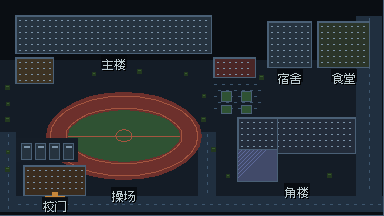

# CAMPUS_SCHOOL · 学校模板的整张地图（2026-11-28）

> 事实源：`data/campus/school.json`（画布 384×216，北在上）。
> 渲染：`game/ui/campus_map.gd`；门禁：`game/tests/campus_map.gd` → `design/previews/CAMPUS_school_map.png`；数据规则 `R48`。
> 参照：用户提供的校园鸟瞰图（长条主教学楼在北、操场在其南、看台在操场东北、宿舍食堂在东、L 形角楼压东南路口、校门在西南）。



---

## 1. 一句话

**学校不再是一间走廊换五套皮，而是一整张图。** 图上有 10 个区块、4 条路、17 丛树、14 个感染体位、3 个容器位；
玩家记路靠这张图，剧情推进也照着这张图走。

## 2. 区块表（图上位置 → 进去是什么 → 这段剧情发生什么）

| 区块 | 图上 | 层数 | 进去是什么 | 这段的剧情 |
|---|---|---|---|---|
| `gate` 校门 | 西南，贴南侧道路 | 1 | 传达室（**安全屋**，门能从里面锁上） | 起点。第一次进来是逃，第二次进来是躲 |
| `main_building` 主楼 | 北，东西向长条 | 5 | 一层走廊：教室1/2/3、实验室；东侧楼梯 | 开场把人按在这里；铃声断掉的那一刻也在这一层的男厕 |
| `west_wing` 西副楼 | 主楼西端 | 3 | 教务、器材室 | 器材室钥匙 = 学校模板的身份物 |
| `track_field` 操场 | 中部，跑道 + 草地 | — | 露天大空地 | 横穿是捷径，也是赌命：视野全开、无处可躲 |
| `grandstand` 看台 | 操场东北 | 1 | 看台下的器材堆 | 报警铃响时体育器材散在这里 |
| `plaza` 广场 | 主楼与角楼之间 | — | 四个方形花坛 | 唯一能挡视线的东西；容器最多的一段 |
| `dorm` 宿舍 | 东北 | 4 | 宿舍走廊、水房 | 爆发那晚有人把门从里面顶住，第二天还顶着 |
| `canteen` 食堂 | 东北角 | 2 | 就餐区、后厨（连东侧卸货口） | 噪音最容易在这里堆起来 |
| `corner_building` 角楼 | 东南，L 形 + 玻璃转角 | 5 | 门厅、东廊、楼梯间 | 这条路线的最后一栋；视野最好，撤不回来 |
| `parking` 停车区 | 西南，校门北侧 | — | 4 个车位 | 校车与几辆私家车，车门有开有关 |

## 3. 线性叙事路线（`route`）

```
校门 → 主楼 → 西副楼 → 操场 → 看台 → 广场 → 宿舍 → 食堂 → 角楼
```

- **起点固定是安全屋**（`safehouse = gate`，门禁断言 `route[0] == safehouse`）；
- 每一站只解决一件事：`校门` 学会进出、`主楼` 学会搜刮与被追、`西副楼` 拿到钥匙、
  `操场` 学会"空地=暴露"、`看台` 拿到第一把近战、`广场` 学会用花坛挡视线、
  `宿舍`/`食堂` 是两条支线（可跳过，但会缺物资）、`角楼` 收束到结局判定。
- 每个有 `interior` 的区块都必须出现在 route 上（门禁断言），不允许"图上有、路上没有"。

## 4. 开场四拍（`intro.beats`，门禁锁死顺序）

| # | id | 时长 | 镜头 | 旁白 |
|---|---|---|---|---|
| 1 | `bell` | 4.0s | 黑场 | 上课铃响了。第三遍。／走廊上的人开始往教室走。 |
| 2 | `overview` | 6.0s | 整图 | 整座学校在灰光里摊开。／记住这条路：校门 → 主教学楼 → 操场 → 角楼。 |
| 3 | `toilet` | 9.0s | 整图（压到主楼一层） | 一楼男厕。三个学生在骂骂咧咧。／有人把烟头弹进最后一个坑位。 |
| 4 | `alarm` | 5.0s | 推近到主楼入口 | 铃声戛然而止。／半秒后，急促的报警铃压了下来。 |
| 5 | `zoom` | 3.0s | 玩家身上 | 镜头落在他身上。／从现在起，走廊由你走。 |

拍子里的 `camera` 是给将来那支过场脚本的枚举：`black` / `map_fit` / `map_zoom` / `player`。

## 5. 与「五张换皮」的差别（本轮改了什么）

| 以前 | 现在 |
|---|---|
| 五栋楼 = 同一间 640px 走廊 + 5 套 tile（`ROOM_PARTITION_TILES` 写死在 `corridor.gd`） | 学校有自己的整张图（10 区块），每个区块带 `story` / `interior` / 自己的敌人与容器配比 |
| 敌人固定 2 只（`ENEMY_SPAWNS` 常量），位置跟楼无关 | `enemy_slots` 按区块分布（主楼 4 / 角楼 3 / 操场 2 / 食堂·宿舍·广场·西副楼·校门各 1，共 14） |
| 容器只按「A/B/C 区」挑 | `containers` 按区块挂（储物柜·急救柜在主楼，垃圾桶在食堂） |

**还没做的**：把区块接成可玩房间（现在是"图有了、路还没通"）。下一刀见 §6。

## 6. 下一步（按顺序）

1. **区域=房间**：`corridor.gd` 的 `_current_building` 之外再加 `_current_region`，房间由 `data/campus` 的区块参数化
   （props / 敌人 / 容器 都从区块读，不再有硬编码常量）；进出靠 `entrance` 点。
2. **开场过场**：`game/ui/intro_sequence.gd` 按 `intro.beats` 逐拍播，`bell/alarm` 用视觉替代（项目里还没有音频资产）。
3. **图内导航**：把这张图做成 ≡ 菜单里的"校园图"页，标当前位置与已探索区块。
